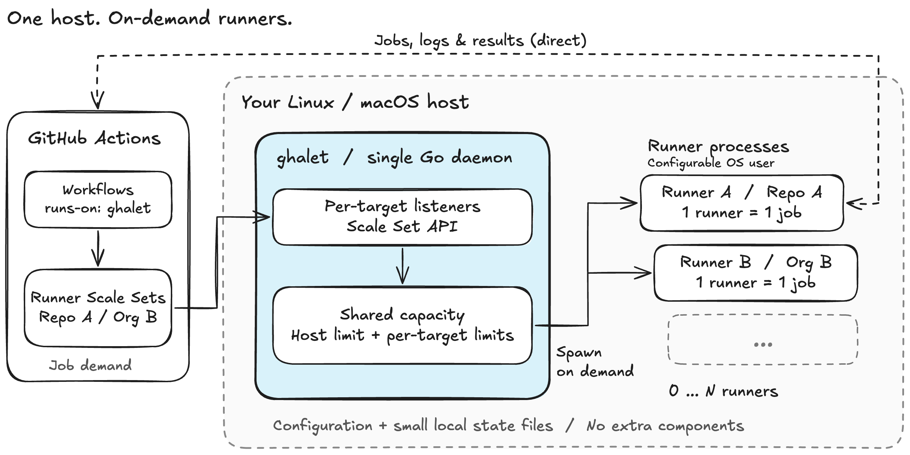

# ghalet

[][actions]
[][codecov]
[][license]
[][PkgGoDev]
[][deepwiki]

[actions]: https://github.com/Songmu/ghalet/actions?workflow=test
[codecov]: https://codecov.io/gh/Songmu/ghalet
[license]: https://github.com/Songmu/ghalet/blob/main/LICENSE
[PkgGoDev]: https://pkg.go.dev/github.com/Songmu/ghalet
[deepwiki]: https://deepwiki.com/Songmu/ghalet

[English](./README.md)

**軽量でシンプルな、GitHub Actions Self-hosted runner コントローラー**

- **単一の Go デーモンと設定ファイルで動作**
  - Kubernetes や DB などの依存コンポーネントは不要
  - 構成が小さく、保持する状態も少ないため、導入も再構築も容易
- **オンデマンドな runner のスケーリング**
  - ホスト上のネイティブプロセスとして runner が軽量に動作
  - 実行ユーザー指定による最低限の権限分離
- **複数のリポジトリ・Organization をまとめて管理**
  - 1台のホストを複数のプロジェクトで共有
  - 全体と個別それぞれのスケーリング設定による細やかな同時実行数制御



runner の厳密な隔離は行わない割り切りなので、独立した専用ホスト、
具体的には以下のような環境上での動作を想定しています。

- 高性能な専用ビルドマシン
- 単一用途の VM
- Mac mini や余ったノート PC などの自宅サーバー

ghalet は Linux / macOS 上で GitHub Actions Runner Scale Set を管理します。
各 runner は1ジョブを実行して終了し、ghalet が runner 専用ディレクトリと
workspace を削除します。増減するのは **単一ホスト上の runner プロセス** であり、
ホスト自体ではありません。
複数マシンのオーケストレーションや、ジョブごとの VM / コンテナの作成は行いません。
**Ephemeral な登録はジョブの隔離を意味しません。** ジョブは実行ユーザーの HOME、
ツール、キャッシュ、権限を共有します。信頼できる workflow のみに使用し、
信頼できない fork PR や悪意あるコードは実行しないでください。Docker actions、
ジョブコンテナ、サービスコンテナには対応していません。

## インストール

systemd unit を含む Linux 向け `.deb` / `.rpm` パッケージと、
GHCR のコンテナイメージもリリース時にビルドします。
導入・設定・更新の手順は[パッケージとコンテナ](./docs/distribution.ja.md)を参照してください。

Homebrew でインストールできます。

```sh
brew install Songmu/tap/ghalet
```

または Go でインストールできます。

```sh
go install github.com/Songmu/ghalet/cmd/ghalet@latest
```

ホストの前提条件と実行ユーザーの要件は
[導入ガイド](./docs/getting-started.ja.md#インストール)を参照してください。

## クイックスタート

[導入ガイド](./docs/getting-started.ja.md#クイックスタート)に、認証、設定、workflow の作成、
最初のジョブ実行までの手順をまとめています。
[Homebrew による macOS の常駐化](./docs/getting-started.ja.md#homebrew-での常駐化macos-のみ)
も説明しています。継続運用では Linux は systemd、macOS は launchd を使用してください。

## コマンド

すべてのコマンドで `--config PATH` を指定できます。**target** は設定内の
リポジトリまたは Organization の登録単位で、ローカルでは `id` で識別します。

| コマンド | 用途 |
| --- | --- |
| `ghalet run` | 全 target のデーモンをフォアグラウンドで起動します。 |
| `ghalet apply` | 全 target を drain して設定と登録を反映し、未使用 Scale Set の削除を試みます。 |
| `ghalet config validate` | GitHub に接続せず、設定とローカルパスを検証します。 |
| `ghalet app setup --scope OWNER/REPO --scale-set ghalet-runner` | 非公開 GitHub App を作成・インストールし、managed 認証を保存して、必要な静的 target 設定を表示します。Organization、SSH、再開は [App セットアップ](./docs/app-setup.ja.md)を参照してください。 |
| `ghalet systemd app setup --scope OWNER/REPO --scale-set ghalet-runner` | App のセットアップ、サービス用の暗号化認証情報の保存、target の実行時の鍵の参照設定を行います（Linux/root）。[App セットアップ](./docs/app-setup.ja.md#パッケージの-systemd-サービス)を参照してください。 |
| `ghalet credential set NAME --prompt` | 静的設定を書き換えず、所有者限定の認証ファイルを保存して managed の共通認証を更新します。App キーや交換は[通常ファイルの認証情報](./docs/file-credentials.ja.md)を参照してください。 |
| `ghalet systemd credential set NAME --prompt` | サービス用 PAT を暗号化登録し、managed の共通認証を更新します（Linux・root 必須）。App キー、自動構築、ローテーションは[認証情報](./docs/credentials.ja.md)を参照してください。 |
| `ghalet list` | アクセス可能なデーモンの管理 UID、ソケット、稼働状態を一覧表示します。`--config PATH` で絞り込めます。 |
| `ghalet status` | 状態と容量を取得します。取得成功は正常稼働を意味しません。 |
| `ghalet doctor` | デーモンを診断し、問題があれば非ゼロで終了します。 |
| `ghalet gc [--dry-run]` | 停止確認済みの実行と期限切れログを削除します。`--dry-run` で事前確認できます。 |

`ghalet --version` でバージョンを表示します。App・認証情報のセットアップ案内を除き、
管理コマンドの応答は JSON です。`systemd app setup` と `systemd credential set` のデフォルト設定パスは
`/etc/ghalet/config.yaml` です。`status`、`doctor`、`apply`、`gc` は `--config` を
省略すると、アクセス可能なデーモンが 1 件なら自動選択し、複数なら設定の明示を求めます。
見つからない場合は、`run` や `config validate` と同じくユーザーごとの
`~/.config/ghalet/config.yaml` を使います。
終了コード、オフラインでの保守、削除時の安全確認については
[設定反映](./docs/operations.ja.md#設定反映)と
[診断と cleanup](./docs/operations.ja.md#診断ガベージコレクション)を参照してください。

## 実行時の動作

ホスト全体の同時実行上限はデフォルトで 2 です。target ごとの上限と待機用の warm pool を
設定でき、割り当て済みジョブを優先します。クラッシュ後はアトミックなステートファイルと
カーネルのプロセス識別情報から復旧し、確認できない実行は容量を予約したまま保留します。

runner のアーカイブは固定バージョンを自動ダウンロードし、公式 SHA-256 ダイジェストで
検証します。デーモンの標準出力は JSONL で、デフォルトでは cleanup 前に runner ログを
退避します。再試行、復旧、ログ保存方針の詳細は[運用ガイド](./docs/operations.ja.md)を
参照してください。

## ドキュメント

まずは[ドキュメントの目次](./docs/index.ja.md)を参照してください。
リポジトリ上でも[ドキュメントサイト](https://songmu.github.io/ghalet/)でも読めます。
各ガイドは英語・日本語で用意しています。

- [導入ガイド](./docs/getting-started.ja.md): インストール、認証、最初の workflow、
  サービスとしての常駐化。
- [認証のセットアップ](./docs/authentication.ja.md): 各方式のメリット・注意点、
  PAT と GitHub App の最小権限・作成手順・ローテーション。
- [運用ガイド](./docs/operations.ja.md): 認証、設定、実行環境、復旧、ログ、
  systemd / launchd / Lima での常駐化。
- [設定サンプル](./examples/config.yaml)と[設定スキーマ](./schema.yaml)。

## 開発

開発、テスト、パッケージング、ドキュメントサイトの保守は
[開発者ガイド](./CONTRIBUTING.ja.md)を参照してください。

## 作者

[Songmu](https://github.com/Songmu)
