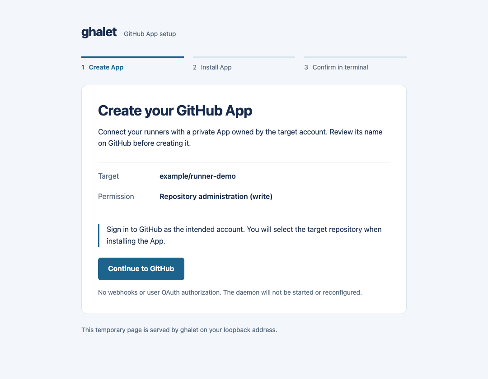
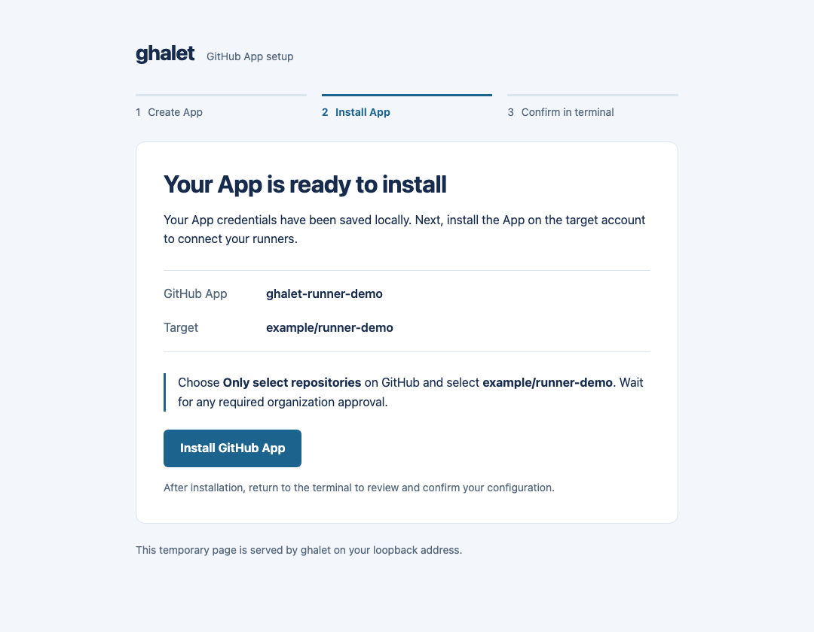

# GitHub App のセットアップウィザード

[English](app-setup.md)

`ghalet app setup --scope OWNER/REPO --scale-set project` は [GitHub の Manifest フロー][manifest]で、
個人または Organization が所有する非公開の GitHub App を作成します。
事前の PAT、client secret、公開コールバックサービス、PEM のコピー＆ペーストは不要です。
Linux / macOS で **GitHub.com** に対応し、一回のセットアップで一つの target を検証します。
保存先は[暗号化されていない通常ファイル](file-credentials.ja.md)です。
`ghalet systemd app setup` は代わりにサービス用の暗号化認証情報を保存します。
どちらもデーモンの起動や設定反映は行いません。

## ローカルでのセットアップ

デーモンと同じユーザー・StateDir の環境で実行してください。

```sh
ghalet app setup --scope OWNER/REPO --scale-set project
# Organization の target:
ghalet app setup --scope ORG --scale-set project
# 設定先を指定する場合:
ghalet app setup --scope OWNER/REPO --scale-set project --config ./config.yaml
# Organization の runner group:
ghalet app setup --scope ORG --scale-set project --runner-group linux
```

別の設定ファイルには `--config PATH` を使います。
デフォルトは `~/.config/ghalet/config.yaml` です。
`--scope` と `--scale-set` は必須です。scope には GitHub.com の
Organization / リポジトリの HTTPS URL も使えます。
確認後に別の [managed ファイル](operations.ja.md#セットアップで管理する情報)へ認証情報を保存します。
デフォルトでは `installationId` を含む認証情報全体を `defaults.credential` に保存します。
`--target` を指定すると、managed の target 固有の認証情報として保存します。
どちらかの設定に `defaults.credential` が既に存在する場合は、App 作成前に停止し、
`--target` または `--overwrite` の指定を促します。`--overwrite` は managed の共通認証を
置き換え、静的設定の共通認証も削除して新しい共通認証を有効にします。
共通認証を継承する target に影響しますが、target に明示した認証は引き続き優先します。
`--yes` だけでは上書きを許可しません。
target の scope・Scale Set・任意の runner group は、静的設定になければ追加し、
設定ファイル自体がなければ作成します。
正規化した scope・runner group・Scale Set が同じ既存 target を再利用します。
`--scale-set` は GitHub 上の登録名と workflow の `runs-on` ラベル、
`--runner-group` は Organization の runner group を指定します。
group を省略するとデフォルトグループを使います。`--id` オプションはありません。
認証情報のファイル名には登録情報から導出した SHA-256 キーを使うため、
任意の ID を付けずに scope・group・Scale Set ごとに分離できます。
既存 App の権限を広げる処理は行いません。同じインストールで必要なアクセス権を持つ
他の target は、共通認証を継承して利用できます。

1. 端末で target、App の所有者、必要な書き込み権限を確認します。
   リポジトリでは `Administration`、Organization では `Self-hosted runners` です。
2. ローカルのブラウザ画面で **Continue to GitHub** を選びます。
   意図したアカウントでログインし、提案された App 名を確認して作成してください。
   Organization のポリシーやアカウントの権限によっては owner の操作が必要です。
3. GitHub がローカルのコールバックへ戻ります。CLI は一時コードを交換して鍵と
   公開の App 情報を保存してから **Install GitHub App** を表示します。
   ボタンを押すと同じブラウザタブで先に進めます。インストール URL は端末にも表示します。
4. 対象アカウントにインストールしてから端末へ戻ります。リポジトリの target では
   **Only select repositories** でそのリポジトリだけを選び、必要な承認を待ちます。
5. CLI はインストールを検出し、App・アカウント・必要な書き込み権限を検証して、
   認証情報の保存先と設定変更を表示します。`y` で保存するか、辞退して後から再開します。
   `--yes` が省略するのは最後の設定保存の確認だけで、GitHub 側の承認は省略しません。

以下のブラウザ画面はサンプルデータを使っています。





credential に `type: github-app`、`clientId`、`privateKeyFile`、`installationId` を保存します。
`--target` の場合は、静的設定の target と照合する scope・Scale Set・runner group も
managed のエントリーに保存します。共通認証に保存する場合は、選択した target の既存の
managed 認証を削除し、共通認証を継承するようにします。
有効になるのは静的設定に記載された target だけで、その target に認証を明示していれば
managed の情報より優先します。
ユーザーの OAuth 認可や Webhook イベントは要求せず、Webhook の配信は無効です。
作成した App は所有アカウント内だけで利用できます。

一時的な loopback サーバーは App の認証情報を保存し、コールバック画面を返してから、
または失敗時に終了します。読み込み済みのインストールリンクはサーバー終了後も使えます。
既存 App からの再開時はインストール URL を端末に表示し、
`--no-browser` がなければブラウザでも開きます。
コールバックのランダムな `state` と Host を検証し、鍵をブラウザの画面・URL・
コマンド出力には含めません。インストールの検出には App JWT を使い、
ユーザートークンやブラウザから渡された installation ID は使いません。

保存した設定を確認してから実行します。

```sh
ghalet config validate
ghalet run
```

既存デーモンには別のデーモンを起動せず、
[`ghalet apply`](operations.ja.md#設定反映) を明示的に実行してください。
セットアップ成功はインストールと権限の確認であり、実際の runner・ジョブの実行確認ではありません。

## SSH とブラウザの手動操作

ブラウザから CLI の loopback コールバックに到達できる必要があります。
SSH ホストでは、ブラウザのあるマシンから固定ポートを転送します。

```sh
ssh -L 8765:127.0.0.1:8765 runner-host
# In that SSH session:
ghalet app setup --scope OWNER/REPO --scale-set project \
  --listen 127.0.0.1:8765 --no-browser
```

SSH 接続を維持したまま、表示された URL をローカルのブラウザで開いてください。
`--no-browser` だけではリモートの localhost に到達できません。
待受先は loopback IP アドレスに限り、`0.0.0.0` や公開インターフェースは使えません。
同じホストで手動操作する場合は、SSH 転送なしで `--no-browser` を使えます。
公開のコールバックや Webhook エンドポイントは不要です。

## パッケージの systemd サービス

Linux、root 権限、systemd 250 以降で実行します。

```sh
sudo ghalet systemd app setup --scope OWNER/REPO --scale-set project
sudo ghalet config validate --config /etc/ghalet/config.yaml
sudo systemctl enable --now ghalet
```

設定先のデフォルトは `/etc/ghalet/config.yaml` です。`--config PATH` で変更できますが、
サービス unit の `ExecStart` や設定先は変更しません。
設定がなければ、パッケージ用の `runner.user: ghalet-runner` と
`logs.root: /var/log/ghalet/runners` を含む設定ファイルを作成します。
`/etc/ghalet/config.yaml` に対する managed 情報のデフォルト保存先は
`/var/lib/ghalet/managed.yaml` です。別の config パスでは `managedFile` を明示するか、
サービスと同じ `STATE_DIRECTORY` を一貫して使ってください。起動前に設定を確認してください。

root でブラウザを起動しなくて済むよう、デフォルトでは URL を表示します。
SSH では上記のポート転送を使い、systemd コマンドに
`--listen 127.0.0.1:8765` を追加して、手元のブラウザで URL を開いてください。

鍵は平文の PEM を書かずに、`/etc/ghalet/credentials/KEY.cred` へ直接暗号化保存します。
専用 drop-in が `LoadCredentialEncrypted` で読み込み、credential の `privateKeyFile` は
`/run/credentials/ghalet.service/KEY` を参照します。再開用の公開情報は
`/etc/ghalet/credentials/KEY.app.json` に保存します。`KEY` は登録情報から導出したキーです。
再開時の復号はメモリ上だけで行います。
登録時に unit 定義を再読込しますが、サービスの起動・再起動は行いません。
サービスへの登録前に暗号化した鍵と再開用の情報を保存します。
drop-in の作成や unit の再読込に失敗しても保持するため、表示された問題を解消して
同じコマンドを再実行すれば、App を作り直さずに登録を再試行できます。
起動済みのサービスには通常停止・正常終了の確認・起動で認証情報を渡してください。
`apply` では systemd の認証情報は更新されません。
ホスト鍵の保護、バックアップ、ローテーションは[暗号化した認証情報](credentials.ja.md)を
参照してください。

## 再開と認証情報の保存

通常版では鍵を `<StateDir>/credentials/KEY.pem` に保存し、`KEY.app.json` に公開の App 識別情報・
scope・鍵のパスを保持して再開できるようにします。
両方とも `0600` で、認証ディレクトリは `0700` です。
JSON に PEM、client secret、webhook secret は保存しません。
PEM とバックアップは[通常ファイルの認証情報](file-credentials.ja.md)の説明どおり保護してください。

一回の待機時間は最大 15 分です。中断、設定保存の辞退、インストールの承認後は、
同じコマンド・設定・scope・Scale Set・runner group で再実行します。
App 情報の保存後は既存の App と鍵を再利用し、App の再作成や鍵の交換は行いません。
scope・所有者・鍵のパスの不一致、App 情報のない既存の鍵、同じ登録先のセットアップの同時実行、
設定ファイルの同時編集は拒否します。GitHub App を自動削除することはありません。

GitHub で App 作成後、認証情報の保存前にコールバックや交換が失敗した場合は、
やり直す前に App の設定を確認してください。Manifest の交換は GitHub の制限である
1 時間以内に完了する必要があります。鍵の保存後に App 情報を書けなかった場合は、
エラーに保持した鍵のパスを表示します。むやみに App を再作成せず、
既存 App の設定と認証情報の手動取り込みを使ってください。

既存の target 登録は重複追加しません。静的設定の変更が不要なら、内容はそのまま保持します。
更新時もコメント・マッピングの順序・既存の権限・ファイルのシンボリックリンクは保持し、
新しいファイルは `0600` で作成します。
managed ファイルは実行ユーザー所有で、他ユーザーが書き込めない必要があります。
managed の同時更新は拒否します。
インストール権限の検証で runner group のアクセス設定は変更しません。

既存 App の鍵には、新しい App を作らず
[`ghalet systemd credential set`](credentials.ja.md#github-app-と追加の認証情報)を使います。
`--no-default` を指定しなければ managed の共通設定を更新しますが、
target に明示された認証設定が引き続き優先されます。

App の秘密鍵は有効期限がなく、installation token は自動更新します。
鍵はポリシーや漏えいの疑いに応じて交換します。
[認証情報とローテーション](authentication.ja.md#認証情報のローテーション)も参照してください。
この機能で、同じユーザーのジョブから認証情報を隔離することはできません。

[manifest]: https://docs.github.com/ja/apps/sharing-github-apps/registering-a-github-app-from-a-manifest
